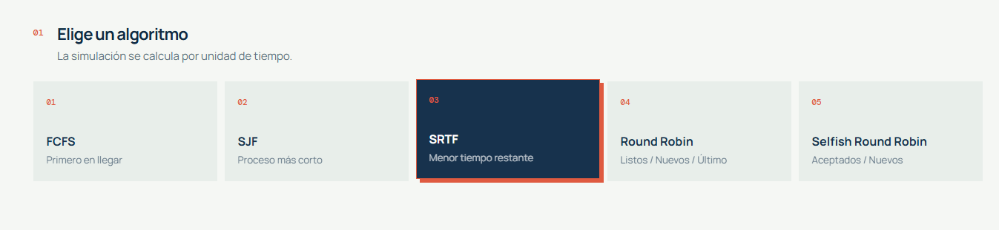
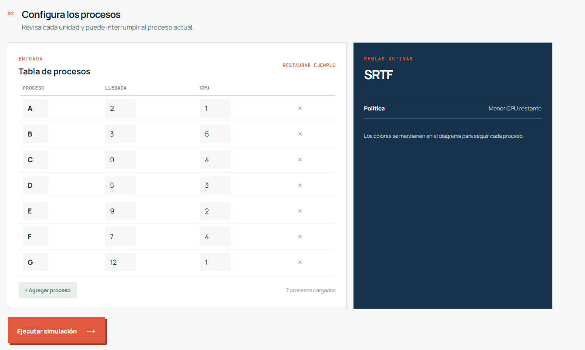
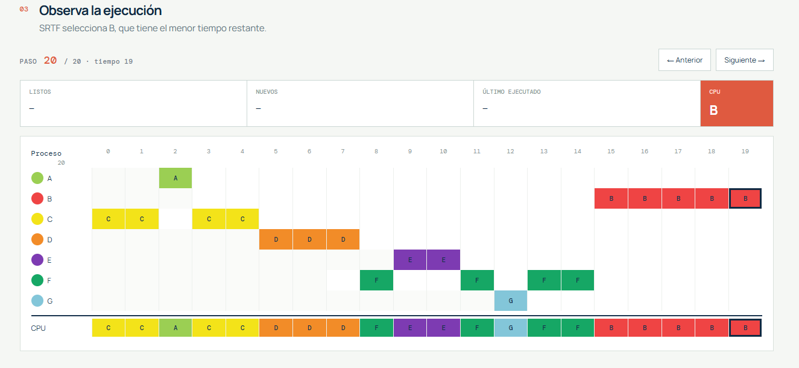
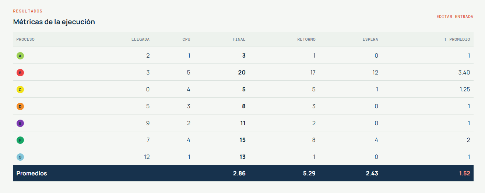

# CPU Scheduler Lab

## 1. Descripción

CPU Scheduler Lab es una aplicación web educativa para estudiar la planificación
de procesos en una CPU. Permite ingresar procesos, elegir un algoritmo, observar
el orden de ejecución y consultar las métricas finales.

La aplicación fue desarrollada con Angular 21, TypeScript, HTML y CSS. Todo el
procesamiento se realiza localmente en el navegador; no requiere servidor,
base de datos ni conexión a una API.

## 2. Objetivo

El objetivo es mostrar de manera visual cómo diferentes algoritmos deciden qué
proceso utiliza la CPU en cada unidad de tiempo. El sistema también permite
avanzar y retroceder por la simulación para estudiar cada decisión.

## 3. Algoritmos implementados

### FCFS

First Come, First Served. Ejecuta los procesos según su orden de llegada y deja
que cada proceso termine antes de seleccionar otro. Es no expropiativo.

### SJF

Shortest Job First. Selecciona, entre los procesos disponibles, el que tiene el
menor tiempo total de CPU. Es no expropiativo.

### SRTF

Shortest Remaining Time First. Selecciona el proceso con menor tiempo restante y
puede interrumpir el proceso actual cuando aparece una opción más corta.

### Round Robin

Entrega turnos de CPU según un quantum configurable entre `1` y `20`. Cuando un
proceso no termina durante su quantum, vuelve al final de la cola. La traza
visualiza `Listos`, `Nuevos` y `Último ejecutado`.

### Selfish Round Robin

Utiliza los grupos `Aceptados` y `Nuevos`. Los aceptados aumentan su prioridad
en `+1` por unidad, mientras que los nuevos aumentan en `+2`. Un proceso nuevo
entra a aceptados cuando alcanza la prioridad mínima aceptada. El quantum de la
variante implementada es `1`.

La variante se reconstruyó a partir del material de clase proporcionado. El
Excel de referencia tenía algunas inconsistencias, por lo que el programa
calcula nuevamente los resultados y nunca permite esperas negativas.

## 4. Flujo de uso

1. Seleccionar uno de los cinco algoritmos.
2. Revisar o editar los procesos de ejemplo A-G.
3. Agregar o eliminar procesos si es necesario.
4. Ingresar el quantum cuando se utiliza Round Robin.
5. Presionar **Ejecutar simulación**.
6. Revisar el diagrama completo y la tabla final.
7. Presionar **Siguiente** para iniciar el modo paso a paso.
8. Presionar **Anterior** para eliminar el último paso visible.

## 5. Pantallas del sistema

### Selección del algoritmo



La captura real presenta los cinco algoritmos y una descripción corta de cada uno.

### Entrada de procesos



La tabla permite editar identificador, llegada y tiempo de CPU. Las validaciones
son:

- Identificador obligatorio y único.
- Llegada entera entre `0` y `20`.
- CPU entera entre `1` y `20`.
- Quantum entero entre `1` y `20` para Round Robin.

### Diagrama y recorrido



Al ejecutar se muestra el diagrama completo. Al presionar `Siguiente`, el sistema
entra al modo paso a paso y dibuja solo lo ejecutado hasta ese instante. La
unidad actual queda marcada con un borde oscuro. `Anterior` elimina visualmente
la última unidad mostrada.

### Resultados



La tabla incluye el tiempo final, retorno, espera, retorno normalizado y sus
promedios.

## 6. Fórmulas

```text
T Final = último instante de ejecución + 1
T Retorno = T Final - T Llegada
T Espera = T Retorno - Tiempo CPU
T Promedio = T Retorno / Tiempo CPU
```

La columna `T Promedio` corresponde técnicamente al retorno normalizado.

## 7. Arquitectura sencilla

```text
src/app/scheduler.ts
    Algoritmos, trazas y métricas
             |
             v
src/app/app.ts
    Estado Angular con signals
             |
             v
src/app/app.html + app.css
    Formulario, diagrama y tabla
```

El motor no depende de Angular. Recibe procesos y configuración, y devuelve un
resultado común para que la interfaz pueda mostrarlo de forma completa o paso a
paso.

## 8. Instalación y ejecución

Requiere Node.js compatible con Angular 21.

```bash
npm install --legacy-peer-deps
npm start
```

Abrir `http://localhost:4200/`.

## 9. Build y pruebas

```bash
npm run build
npm test -- --watch=false
```

Las pruebas comprueban el consumo exacto de CPU, la correspondencia entre cada
paso y el timeline, el cambio de Round Robin con distintos quantums y la
secuencia reconstruida de Selfish Round Robin.

## 10. Código fuente

El código fuente principal se encuentra en:

```text
src/app/scheduler.ts
src/app/app.ts
src/app/app.html
src/app/app.css
src/styles.css
src/app/scheduler.spec.ts
src/app/app.spec.ts
```

Para generar un documento único con el código:

```bash
npm run export:source
```

El resultado se guarda en `docs/SCRIPT-FUENTE.md`.
